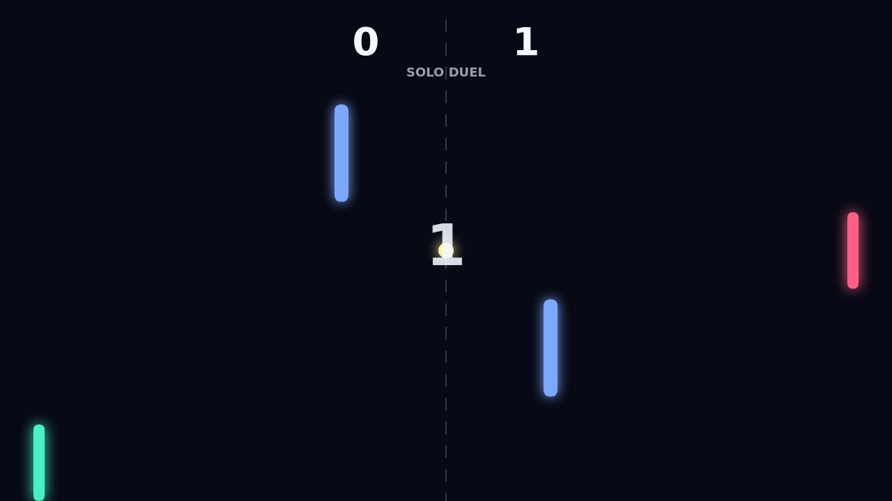

# Carom

Carom is a fast top-down paddle duel where every clean return can become a
bank-shot problem. The field is compact, the paddles are bright, and the center
obstacles keep the ball from ever feeling like it is traveling down an empty
lane.

The match starts with a short hold at center court, then the serve snaps toward
one side and the rally begins. You guard the goal line, read the bounce off the
walls, and try to send the ball through angles your opponent cannot cover.

Spin is the trick. Move as you strike and the ball keeps curving after contact,
letting a late return hook around an obstacle or dive away after a wall bounce.
At match point, the best shots feel less like straight power and more like
setting a trap in motion.
